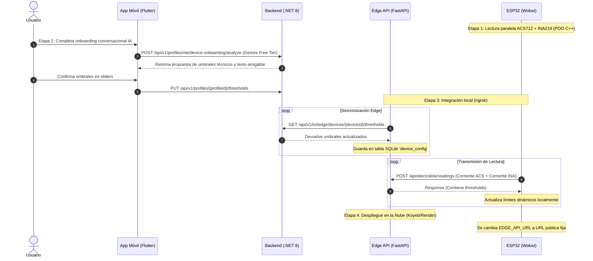

# Plan de Implementación: Conectividad IoT, Onboarding de Umbrales con IA y Visualización de Métricas (POO & Por Etapas)

Este plan detalla la hoja de ruta técnica para conectar el simulador ESP32 de Wokwi, la Edge API de FastAPI y el backend en .NET 8, integrando sensores simultáneos bajo una arquitectura POO en C++, calibración inteligente basada en Gemini y el despliegue final en la nube.

---

## User Review Required

> [!IMPORTANT]
> **Arquitectura POO del Firmware:** Se re-estructurará el código del ESP32 para usar clases abstractas bases (`Sensor` y `Actuator`) y clases hijas derivadas (`Acs712Sensor`, `Ina219Sensor`, `RelayActuator`, `BuzzerActuator`).
>
> **Simultaneidad de Sensores:** Se mantendrán tanto el sensor analógico **ACS712** como el sensor digital I2C **INA219** funcionando en paralelo dentro del firmware. Las lecturas de corriente de ambos se reportarán en la telemetría.
>
> **Modo Demostración (Offline):** Se introduce la directiva `#define OFFLINE_DEMO_MODE` en `Config.h` que permitirá conmutar el firmware entre lectura de umbrales dinámicos (simulación Wokwi) y umbrales estáticos fijos locales (versión física de la expo sin internet).
>
> **Protección Local Preventiva:** El firmware ESP32 apagará local e inmediatamente el relé si detecta que la corriente medida por el INA219 supera los umbrales dinámicos establecidos por la IA, antes de esperar la respuesta del servidor Edge.

---

## Open Questions

> [!WARNING]
> Ambos dispositivos I2C (la pantalla OLED y el sensor INA219) compartirán las mismas líneas físicas **SDA (Pin 21)** y **SCL (Pin 22)** en el bus I2C. Esto es posible gracias a que la pantalla usa la dirección `0x3C` y el INA219 la dirección `0x40`.

---

## Proposed Steps & Architecture



---

## Proposed Changes by Stage

### Etapa 1: Estructuración POO, Sensores en Paralelo y Calibración Estática/Dinámica
Objetivo: Implementar la jerarquía de clases POO en el ESP32, agregar el sensor INA219 a la simulación y permitir la conmutación entre el modo de simulación y demo física.

**Estado: COMPLETADO** ✅ — Compilación exitosa con `arduino-cli` (ESP32 Dev Module, 83% flash, 15% RAM, 0 errores). Edge API actualizada para soportar payload dual.

#### Estructura POO del Firmware (`c:\Users\RIZE\Downloads\ElectroLink_Migration_Pack\ElectroLinkIoT`):
1. **Clase Base `Sensor` (`Sensor.h`):**
   * Definición abstracta para lecturas de corriente.
   ```cpp
   class Sensor {
   public:
       virtual bool begin() = 0;
       virtual float readCurrent() = 0;
       virtual ~Sensor() {}
   };
   ```
2. **Clase Hija `Acs712Sensor` (en `Acs712Sensor.h`):**
   * Hereda de `Sensor`. Lee corriente a través del ADC analógico.
3. **Clase Hija `Ina219Sensor` (`Ina219Sensor.h`):**
   * Hereda de `Sensor`. En Wokwi se simula con potenciómetro (GPIO 35). En hardware físico usa I2C real (dir 0x40).
4. **Clase Base `Actuator` (`Actuator.h`):**
   * Definición para controles de salida física.
   ```cpp
   class Actuator {
   public:
       virtual void begin() = 0;
       virtual void turnOn() = 0;
       virtual void turnOff() = 0;
       virtual bool isOn() const = 0;
       virtual ~Actuator() {}
   };
   ```
5. **Clase Hija `RelayActuator` (en `RelayActuator.h`):**
   * Hereda de `Actuator`. Controla el estado del relé.
6. **Clase Hija `BuzzerActuator` (en `BuzzerActuator.h`):**
   * Hereda de `Actuator`. Controla el zumbador acústico para peligros.

#### [MODIFIED] [Config.h](file:///c:/Users/RIZE/Downloads/ElectroLink_Migration_Pack/ElectroLinkIoT/Config.h)
* Declarar la directiva `#define OFFLINE_DEMO_MODE` (poner en `true` para la exposición física estática, o `false` para Wokwi dinámico).
* Convertir las constantes `NORMAL_LIMIT` y `ALERT_LIMIT` en variables globales mutables iniciadas por defecto.
* Incluye `#define WOKWI_SIMULATION` para conmutar entre potenciómetro simulado e INA219 real.

#### [MODIFIED] [ElectroLinkIoT.ino](file:///c:/Users/RIZE/Downloads/ElectroLink_Migration_Pack/ElectroLinkIoT/ElectroLinkIoT.ino)
* Re-escrito con instanciación polimórfica de sensores y actuadores.
* **Protección Local Inmediata:** En el bucle principal, si la corriente máxima entre ambos sensores supera `currentAlertLimit`, apaga el relé y activa el buzzer localmente.
* **Auto-recovery:** Al volver a estado NORMAL, el relé se re-activa automáticamente.
* **OLED no fatal:** Si la pantalla no se detecta, el sistema continúa sin ella.
* **ADC resolution:** `analogReadResolution(12)` explícito.

#### [MODIFIED] Edge API — Soporte para payload dual
* `routers/readings.py`: Modelo acepta `currentAcs` y `currentIna`. Respuesta incluye `thresholds` por defecto.
* `database.py`: Migración automática de columna `current` a `current_acs` + `current_ina`.
* `services/sync_worker.py`: Usa `current_acs` + `current_ina`.
* `simulate_device.py`: Envía payload dual.

#### [MODIFIED] diagram.json — Circuito Wokwi
* Pines sincronizados con Pins.h: relé→13, buzzer→14, LEDs→25/26/27.
* Resistencias de 220Ω agregadas a cada LED.
* Potenciómetros con labels "Simula ACS712" y "Simula INA219".
* Múltiples conexiones GND distribuidas (GND.1, GND.2, GND.3).

#### [NEW] WOKWI_README.md
* Documentación completa de simulación, tests y troubleshooting.

#### [REMOVED] EdgeApiClient.h
* Eliminado. Reemplazado por `HttpEdgeGatewayClient.h`.

---

### Etapa 2: Onboarding Conversacional de IA (Mobile & Backend)
Objetivo: Implementar la experiencia amigable donde la IA sugiere los límites de energía y el usuario los confirma.

#### [NEW] [DeviceOnboardingAnalysisService.cs](file:///c:/Users/RIZE/Documents/GitHub/electrolink-backend-api/Profiles/Application/Internal/Services/DeviceOnboardingAnalysisService.cs)
* Servicio en .NET para conectarse con la API de **Gemini 1.5 Flash** (Free Tier en Google AI Studio).
* Usar salidas estructuradas para retornar el mensaje conversacional personalizado y el objeto JSON con el perfil de umbrales `ThresholdConfig`.

#### [MODIFY] [ProfilesController.cs](file:///c:/Users/RIZE/Documents/GitHub/electrolink-backend-api/Profiles/Interfaces/REST/ProfilesController.cs)
* Exponer el endpoint `POST /api/v1/profiles/me/device-onboarding/analyze` para analizar la entrada del usuario.
* Registrar el cambio de umbrales mediante `PUT /api/v1/profiles/{profileId}/thresholds`, disparando la actualización en el contexto `Processing`.

#### [NEW] [device_onboarding_screen.dart](file:///c:/Users/RIZE/Documents/GitHub/electrolink-mobile-app/lib/features/profile/presentation/pages/device_onboarding_screen.dart)
* Diseñar la pantalla de onboarding conversacional:
  * Saludo personalizado al usuario: *"¡Hola [Nombre]! Vamos a empezar..."*
  * Formulario de texto libre para introducir el electrodoméstico.
  * Visualización de las recomendaciones de la IA en formato de sliders interactivos y medidores gráficos.

---

### Etapa 3: Integración Local y Sincronización del Edge API (ngrok)
Objetivo: Sincronizar los umbrales modificados en la app entre el backend, el SQLite de la Edge API y retornarlos al ESP32.

#### [MODIFY] [database.py](file:///c:/Users/RIZE/Documents/GitHub/electrolink-edge-api/database.py)
* Crear la tabla SQLite `DeviceConfig` en Peewee.

#### [MODIFY] [sync_worker.py](file:///c:/Users/RIZE/Documents/GitHub/electrolink-edge-api/services/sync_worker.py)
* Configurar la cabecera `X-Api-Key` en las solicitudes de red salientes al backend.
* Implementar `_pull_device_configurations()` que consume `GET /api/v1/iot/edge/devices/{deviceId}/thresholds` en el backend y almacena la respuesta en SQLite local.

#### [MODIFY] [routers/readings.py](file:///c:/Users/RIZE/Documents/GitHub/electrolink-edge-api/routers/readings.py)
* Al recibir telemetría, buscar en `DeviceConfig` y retornar la sección `"thresholds"` en el JSON de respuesta.

#### [ALREADY DONE in Etapa 1] [HttpEdgeGatewayClient.h](file:///c:/Users/RIZE/Downloads/ElectroLink_Migration_Pack/ElectroLinkIoT/HttpEdgeGatewayClient.h)
* `HttpEdgeGatewayClient` (que reemplazó a `EdgeApiClient.h`) ya parsea el JSON de respuesta y actualiza `currentNormalLimit` y `currentAlertLimit` en caliente via `_parseThresholds()`.
* Para Etapa 3: asegurar que el Edge API retorne thresholds reales desde `DeviceConfig` en vez de los valores por defecto actuales.

#### Conectividad local:
* Abrir el túnel ngrok: `ngrok http 3000`.
* Apuntar `EDGE_API_URL` en `Config.h` a la URL del túnel.

---

### Etapa 4: Migración a la Nube y Despliegue de Edge Service
Objetivo: Desplegar de forma permanente la Edge API para pruebas 24/7 sin computadoras locales activas.

#### Despliegue en la Nube:
* Desplegar la API en **Koyeb** o **Render** de forma gratuita.
* Configurar las variables de entorno `BACKEND_BASE_URL` y `EDGE_API_KEY`.
* En caso de reinicio de la instancia (cuyo almacenamiento es temporal en planes gratuitos), documentar que el `SyncWorker` recuperará automáticamente la configuración llamando de nuevo al backend en su primer bucle.

#### Conexión Directa:
* Reemplazar la URL de ngrok en `Config.h` del ESP32 simulado en Wokwi por la URL permanente en la nube de Koyeb o Render.

---

### Etapa 5: Documentación de Requerimientos e Historias de Usuario (project-document)
Objetivo: Registrar formalmente en los archivos de la memoria del proyecto las adiciones telemétricas y de IA para asegurar el cumplimiento del estándar académico.

#### [MODIFY] [30-cap3-requirements-spec.md](file:///c:/Users/RIZE/Documents/GitHub/project-document/report/30-cap3-requirements-spec.md)
* **Añadir Historias de Usuario (US) nuevas en las tablas:**
  * **US-47 (Calibración por Asistente de IA):** Propietario solicita análisis de electrodoméstico y Gemini propone umbrales.
  * **US-48 (Sincronización Edge):** Descarga periódica de configuraciones de umbrales del backend a la base de datos SQLite del Edge.
  * **US-49 (Protección de Relé Dual):** Lectura paralela ACS/INA y corte de relé autónomo en firmware si hay sobrecarga.
* **Redactar los Criterios de Aceptación (Escenarios Gherkin)** detallados en formato `Dado que / Cuando / Entonces` para cada una de las nuevas US.

#### [MODIFY] [40-cap4-solution-sw-design.md](file:///c:/Users/RIZE/Documents/GitHub/project-document/report/40-cap4-solution-sw-design.md)
* **Actualizar Diagramas de Diseño:**
  * **Diagrama de Clases del Firmware:** Mostrar la jerarquía POO (`Sensor` -> `Acs712Sensor`, `Ina219Sensor`; `Actuator` -> `RelayActuator`, `BuzzerActuator`).
  * **Diagrama de Base de Datos local:** Agregar la entidad `DeviceConfig` en el diseño físico del Edge Gateway.
  * **Diagrama de Secuencia del Onboarding IA:** Ilustrar el flujo de extremo a extremo desde el Flutter al Backend, pasadas de Gemini, almacenamiento de umbrales, sincronización Edge y lectura Wokwi.

#### [MODIFY] [01-registro-versiones.md](file:///c:/Users/RIZE/Documents/GitHub/project-document/report/01-registro-versiones.md)
* Documentar la liberación de la nueva versión del ecosistema incorporando las características de calibración IA e instrumentación redundante en el registro de cambios.

---

## Verification Plan

### Manual Verification
1. **Verificación Etapa 1**:
   - ✅ **Compilación**: `arduino-cli` compila sin errores (ESP32 Dev Module, 83% flash, 15% RAM)
   - ✅ **Edge API**: POST `/api/electrolink/readings` acepta payload dual y retorna `thresholds` (Status 200)
   - ✅ **Migración DB**: columnas `current_acs` / `current_ina` creadas y funcionales
   - ⏳ **Pendiente en Wokwi web**: Iniciar simulación, comprobar lecturas duales en Serial, inducir sobrecorriente y validar corte preventivo del relé
   - ⏳ **Pendiente**: Probar `OFFLINE_DEMO_MODE=true`
2. **Verificación Etapa 2**: Completar el flujo en la pantalla de onboarding en Flutter. Verificar que la IA responda amigablemente saludando al usuario y sugiriendo los umbrales lógicos del dispositivo.
3. **Verificación Etapa 3**: Conectar la Edge API local con ngrok. Validar que el Sync Worker recupere la configuración guardada del backend y que, en la siguiente lectura del ESP32, el firmware actualice sus límites de calibración dinámicos.
4. **Verificación Etapa 4**: Desplegar la Edge API en Koyeb/Render, actualizar el firmware y validar el flujo continuo sin ngrok ni servidores locales activos.
5. **Verificación Etapa 5**: Abrir los archivos md de la carpeta `report` de `project-document` y verificar que las tablas de requerimientos y diagramas reflejen perfectamente la especificación de software del sistema final.
